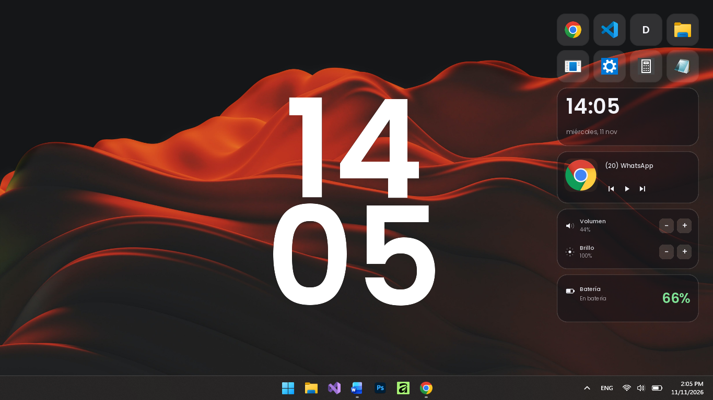
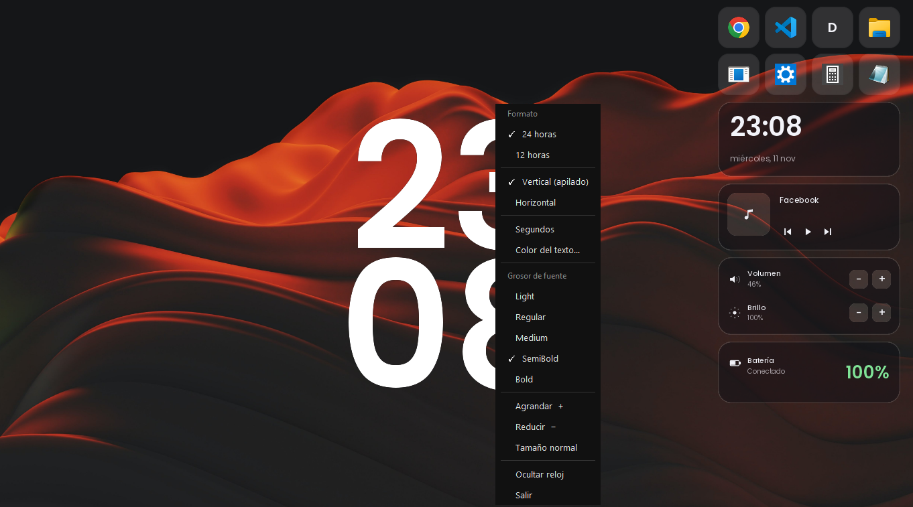
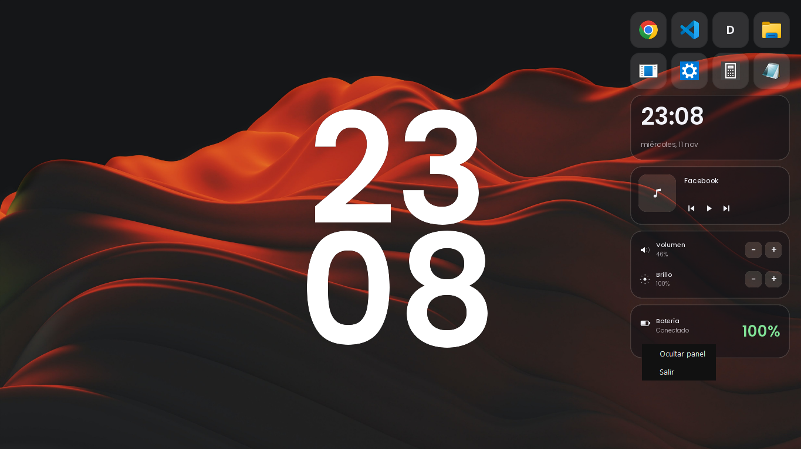

# Widdeks - Reloj y Panel de Escritorio



Widdeks es una aplicación de escritorio para Windows que muestra un reloj personalizable y un panel con acceso rápido a aplicaciones, controles de medios, volumen, brillo y estado de batería. La aplicación se ejecuta en la pantalla y se puede arrastrar y redimensionar según tus preferencias.

## Instalación

[](https://github.com/Vladimir-gs/widdeks/releases/latest)

1. Descarga **`Widdeks-Setup-X.Y.Z.exe`** desde [Releases](https://github.com/Vladimir-gs/widdeks/releases/latest).
2. Haz **doble clic** en el archivo.
3. Pulsa **Siguiente** hasta terminar.

Eso es todo. **No necesitas instalar Python ni nada más**, y **no se piden permisos de administrador**.

> Al finalizar, Widdeks se abre automáticamente y queda disponible en el menú Inicio.

El instalador se encarga de:

- Copiar la aplicación a `%LOCALAPPDATA%\Programs\Widdeks`.
- Configurar el auto-inicio (puedes desmarcarlo en el asistente).
- Crear el acceso directo del menú Inicio.
- Migrar tu configuración si tenías una versión anterior.
- Añadir **Widdeks** a *Aplicaciones instaladas*, con su desinstalador.

**Primer lanzamiento:** verás un reloj digital y un panel en tu escritorio.

## Uso básico

### Interfaz de la aplicación

Al iniciar, verás dos elementos principales en tu escritorio:

- **Reloj**: Un reloj digital en el lado derecho (por defecto) que muestra la hora
- **Panel**: Una barra inferior con acceso a aplicaciones, controles y estado del sistema

### Interacción con el reloj

**Clic derecho sobre el reloj** → Abre un menú con estas opciones de configuración:



| Opción | Descripción |
|--------|-------------|
| **Formato** | Alterna entre 24 horas y 12 horas (AM/PM) |
| **Orientación** | Cambia entre disposición vertical (apilada) u horizontal |
| **Segundos** | Muestra u oculta los segundos en el reloj |
| **Color del texto** | Abre un selector de colores para cambiar el color de la hora |
| **Grosor de fuente** | Elige entre: Light, Regular, Medium, SemiBold, Bold |
| **Agrandar + / Reducir -** | Ajusta el tamaño de la fuente usando los botones del menú |
| **Rueda de mouse** | Desplazando la rueda sobre el reloj, aumentas o disminuyes el tamaño |

**Arrastrar el reloj**: Haz clic y arrastra en cualquier parte del reloj para moverlo a cualquier posición de la pantalla.

**Grip (esquina inferior derecha)**: Un pequeño cuadro en la esquina que puedes arrastrar para redimensionar el reloj manualmente.

**Rueda de mouse sobre el reloj**: Desplázala hacia adelante para hacer el reloj más grande, hacia atrás para hacerlo más pequeño.

### Interacción con el panel

**Clic derecho sobre el panel** → Menú con:



- **Ocultar panel**: Oculta o muestra el panel de escritorio
- **Salir**: Cierra completamente la aplicación

### Accesos directos del panel

El panel incluye secciones interactivas:

**Aplicaciones rápidas**: Botones para lanzar programas configurados (Chrome, VS Code, Discord, Terminal, Explorador, Ajustes, Calculadora, Notas). Cada botón muestra el icono del programa.

**Controles de medios**: Si estás reproduciendo música o video:
- **Anterior**: Canción/anterior
- **Play/Pause**: Reproducción/pausa
- **Siguiente**: Siguiente canción

**Control de volumen**: 
- Botones + y - para subir/bajar el volumen
- Muestra el nivel actual de volumen

**Brillo de pantalla**:
- Botones + y - para ajustar el brillo
- Muestra el nivel actual de brillo

**Batería**: Icono de batería con estado (cargando, en batería, porcentaje)

## Configuración manual (opcional)

Los archivos de configuración se guardan en formato JSON y se pueden editar directamente:

- **`clock_config.json`**: Configura el reloj
  - `x`, `y`: Posición en la pantalla
  - `size`: Tamaño del reloj (150 por defecto)
  - `weight`: Grosor de la fuente (Medium por defecto)
  - `hour24`: true para 24h, false para 12h
  - `seconds`: Mostrar segundos
  - `vertical`: true para vertical, false para horizontal
  - `color`: Color del texto (ej. "#ffffff" blanco)

- **`panel_config.json`**: Configura el panel
  - `x`, `y`: Posición
  - `shortcuts`: Array de accesos directos a aplicaciones

Estos archivos están en `%LOCALAPPDATA%\Widdeks\`.

## Desinstalación

### Si instalaste con el instalador

Ve a **Configuración** > **Aplicaciones** > **Aplicaciones instaladas**, busca **Widdeks** y pulsa **Desinstalar**.

El desinstalador elimina la aplicación, el auto-inicio, los accesos directos y los datos de usuario (`%LOCALAPPDATA%\Widdeks`).

### Si instalaste con el script

Ejecuta:

```powershell
.\clock-widget\desinstalar.bat
```

Esto hará lo siguiente:
- Cerrará todos los procesos de widdeks
- Eliminará la entrada del registro de inicio automático ("Widdeks")
- Removerá el acceso directo del menú Inicio
- Borrará los archivos de `%LOCALAPPDATA%\Programs\Widdeks\`
- Borrará los datos de usuario (`%LOCALAPPDATA%\Widdeks`)
- También removerá la carpeta anterior `RelojWidget` si existe

## Desarrollo

### Ejecutar desde el código (sin compilar)

Requiere Windows 10/11 y Python 3.x con `pythonw.exe` en el `PATH`:

```powershell
Set-ExecutionPolicy -Scope Process -ExecutionPolicy Bypass
.\clock-widget\install.ps1
```

### Compilar el ejecutable y el instalador

```powershell
winget install JRSoftware.InnoSetup   # solo la primera vez
.\tools\build.ps1
```

Resultados:

- `dist\Widdeks\Widdeks.exe` (versión portable onedir)
- `dist\installer\Widdeks-Setup-1.0.0.exe`

Autodiagnóstico del binario empaquetado:

```powershell
Start-Process .\dist\Widdeks\Widdeks.exe -ArgumentList "--selftest" -Wait
Get-Content "$env:LOCALAPPDATA\Widdeks\selftest.json"
```

El workflow de GitHub Actions (`.github/workflows/build.yml`) compila ambos en cada push y publica el instalador al crear un tag `v*`.

## Licencia

Este proyecto se distribuye bajo la licencia **MIT**. Consulta [LICENSE](LICENSE).

## Notas importantes

- **Aviso de SmartScreen**: al abrir el instalador, Windows puede mostrar "Windows protegió tu PC". Pulsa **Más información** > **Ejecutar de todas formas**. Es normal en aplicaciones nuevas que aún no tienen firma digital.
- **Instalación manual (desarrollo)**: si usas el script de PowerShell en vez del instalador, Windows puede mostrar un aviso sobre scripts. Selecciona "Más información" y luego "Ejecutar de todas formas".
- **Auto-start**: Si deseas desactivar el inicio automático, ve a **Administrador de tareas** > **Más detalles** > pestaña **Inicio** y desactiva la entrada "Widdeks".
- **Compatibilidad**: La aplicación está diseñada para Windows 10/11 y usa bibliotecas nativas (pycaw para audio, winrt para controles de medios).
- **Solución de problemas**: Si el brillo o volumen no responden, verifica que tengas instalados los controladores adecuados de tu fabricante de laptop/desktop.
- **Personalización avanzada**: Edita directamente los archivos JSON si quieres configuraciones que no están disponibles en el menú clic-derecho.

---